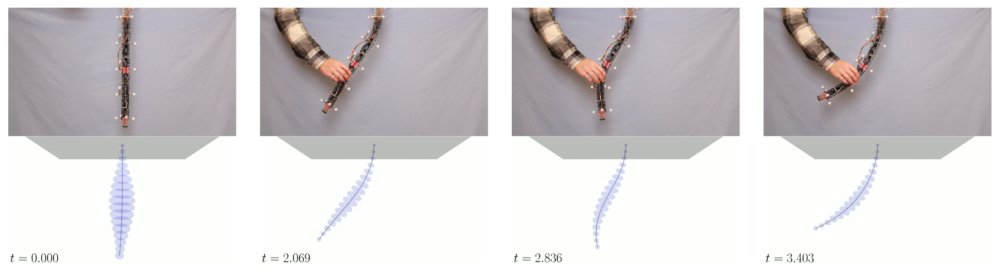
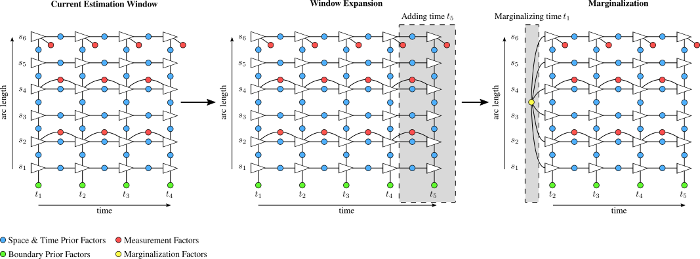

<div align="center">


<h1>Space-Time Continuum</h1>

<p>
A continuous-time-and-space state estimation framework for real-time dynamic state estimation of continuum robots.
</p>
  
<h4>
    <a href="https://arxiv.org/src/2510.26623v1/anc/results_video.mp4">View Demo</a>
    <span> · </span>
    <a href="https://github.com/utiasASRL/space_time_continuum/blob/main/CHANGELOG.md">See Changes</a>
    <span> · </span>
    <a href="https://github.com/utiasASRL/space_time_continuum/issues">Report Bug</a>
    <span> · </span>
    <a href="https://github.com/utiasASRL/space_time_continuum/issues">Request Feature</a>
</h4>

</div>

<br />

📕 <a href="https://arxiv.org/abs/2510.01381">A Stochastic Framework for Continuous-Time State Estimation of Continuum Robots</a>

📕 <a href="https://arxiv.org/abs/2510.26623">A Sliding-Window Filter for Online Continuous-Time Continuum Robot State Estimation</a>

📕 <a href="https://arxiv.org/abs/2602.07209">Continuum Robot Localization using Distributed Time-of-Flight Sensors</a>

<br>

<!-- Table of Contents -->
# Table of Contents

- [About](#about)
- [Getting Started](#getting-started)
  - [Prerequisites](#prerequisites)
  - [Installation](#installation)
  - [Running Demos](#running-demos)
- [Contributing](#contributing)
- [FAQ](#faq)
- [Publications](#publications)
- [Contact](#contact)
- [Acknowledgements](#acknowledgements)
- [License](#license)

<br>

## About

Space-Time Continuum is a continuous-time-and-space estimator for real-time estimation of continuum robots. It achieves real-time runtime with performance that is competitive with state-of-the-art estimation methods. The full breakdown of the theory behind this work, along with details on how to cite this package, can be found in works cited in the [publications](#publications) section. This project remains active with further releases expected in the coming months and years.

### Technical Description

The estimation framework proposed uses a maximum a posteriori (MAP) framework solved via factor-graph optimization. A series of prior factors are proposed which approximate the spatial and temporal dynamics of a Cosserat rod. Three individual solver types are implemented: batch, filter, and sliding-window filter estimators. The two filter-based solvers use an expanding / marginalizing approach to factor-graph construction highlighted in the figure below.



The batch solver cannot grow in size nor does it support marginalization, but rather, performs estimation over a fixed time period. As the estimator is formulated through a factor-graph, it is easy for users to add their own custom factors to integrate sensors and measurement models that are not initially included in this package. If you write a measurement factor for your own work that you feel would be valuable for other researchers, feel free to open a pull request and we can see about adding it to the repository! For more information, see the [contributing](#contributing) sections. For a complete description of the implementation, please see our [publications](#publications).

### When to Use Each Solver

| Scenario / Requirement | Batch                                                                                                                        | Filter                                  | Sliding Window Filter                                                                                    |
|------------------------|------------------------------------------------------------------------------------------------------------------------------|-----------------------------------------|----------------------------------------------------------------------------------------------------------|
| Best for               | Offline problems with short durations that use sensors that are robust to local minima (e.g. FBGS, electromagnetic trackers) | Compute limited, real-time applications | Real-time applications using sensors that are susceptible to local minima (e.g. time-of-flight, cameras) |
| Computational cost     | High                                                                                                                         | Low                                     | Medium-Low depending on window size                                                                      |
| Accuracy               | Highest provided a convex problem. Susceptible to local minima                                                               | Lowest                                  | Good                                                                                                     |

<br>

## Getting Started

This project has been developed and tested in Ubuntu 24.04 LTS. Other Linux distributions are expected to also work, though Windows and MacOS are not.

### Prerequisites

This repository relies on several third party packages listed below that each need to be installed prior to use. The versions numbers provided are the ones this work has been tested and developed with, small variations to version numbers may still work but remain untested.

- [Cmake](https://cmake.org/)
- [Eigen 3.4](https://libeigen.gitlab.io/)
- [VTK 9.3](https://vtk.org/)
- [Qt 6.8.0](https://contribute.qt-project.org/)
- [lgmath](https://github.com/utiasASRL/lgmath) *Note: This dependency will switch to GTSAM in the next version*
- [robin-map](https://github.com/Tessil/robin-map)

### Installation 

```bash
git clone https://github.com/utiasASRL/space_time_continuum 
cd space_time_continuum
./build_release.sh 
```
<!-- 
To run the unit tests, 

```bash
./run_tests
``` -->

### Running Demos

To replay the newest completed training experiment with its learned weights:

```bash
python3 scripts/run_experiment.py
python3 scripts/run_experiment.py --logs-only
python3 scripts/run_experiment.py --lower-only --trial slow_free_space
python3 scripts/run_experiment.py --all-trials
python3 scripts/run_experiment.py --experiment assets/logs/shared_physical_20261015_021741 --all-trials
```

The default opens the lower-level visualizer on the experiment's single held-out
trial. `--logs-only` runs headless and exports logs; `--lower-only` reuses the
previously converted robot config without changing its weights. These flags
can be combined. `--trial` accepts a trial name or exact JSON path. Use
`--experiment` to select an older experiment and `--dry-run` to prepare configs
and print the command without running the estimator. Paths are repository-relative.

`--all-trials` runs every recorded trial (training and held-out) sequentially and
headlessly, generating separate logs and metrics under `lower_level/TRIAL/`.
It cannot be combined with `--trial`. With `--output`, that directory becomes
the parent of the per-trial directories. Combine it with `--metrics-only` to
regenerate all existing trial summaries, or `--dry-run` to prepare all configs.
The run stops and returns a nonzero exit status if a trial fails.
After all trials succeed, `all_trials_summary.csv` is written in the parent
output directory (by default `EXPERIMENT/lower_level/`). It contains separate
`body` and `tip` metrics rows for each trial at full precision, excluding the
base and pooled `all` row, with `trial`, `split` and `region` columns. Body/tip
translation percentages retain their marker-arclength normalization. Splits
come from the saved experiment: `training` for training trials and `validation`
for held-out testing trials. An aligned console table prints percentages,
radians and NEES to two decimal places; metres retain six decimal places to
keep small errors visible (for example, `0.000765m` and `1.35%`).
This combined summary is also regenerated by `--all-trials --metrics-only`,
but not by `--dry-run`.
All-trial runs also save `optimizer_history.png` beside the combined CSV, with
loss (`validation_nll`) and mean pose NEES (`mean_mahalanobis`) versus optimizer
iteration. The source is the experiment's timestamp-matched
`bilevel_optimizer_outer_loop_TIMESTAMP.log`, searched inside the experiment,
beside it, and in `assets/logs/`. The NEES panel includes the nominal 6D
reference of 6; these are upper-level optimizer metrics, not replay metrics.
Plots render headlessly using Matplotlib (`python3 -m pip install matplotlib`).
Missing logs or Matplotlib produce a warning without discarding trial results.
`--all-trials --metrics-only` regenerates the figure; dry runs do not draw it.

The script writes `robot_optimized.json` in the experiment directory, using all
saved P0/Q1/Q2/Q3/Q4 variances and `prior_factor: 1`, while preserving measurement
noise and topology. Recorded trial and estimator configs are used when available.
Logs and console output go to `lower_level/TRIAL/` inside the experiment;
`--robot-config` and `--output` override these paths. No upper-level optimization
is run. Conversion requires final `parameters.json` and `experiment.json`.

Every trial run also exports `logs/pose_metrics.csv`, `logs/metrics_summary.csv`,
and `logs/metrics_summary.json`. Summaries report the base (`abs(s) <= 1e-6 m`),
body markers (`0 < s < L`), the tip (`s = L`), and all markers including the base.
Overall metrics pool samples, rather than equally averaging region summaries.
Translation MAE/RMSE are exported in metres and percentages. Body/tip percentages
use each marker's arclength (`100 * position_error / s`); base and overall
percentages use robot length (`100 * position_error / L`) to avoid division by
zero and give the overall error a common denominator. Orientation MAE/RMSE are in radians. These
are pose errors, not angular-velocity errors; velocity has units rad/s and no
ground-truth velocity is exported by these trials.

Marginal NEES uses the six-dimensional SE(3) pose error and each interpolated
pose covariance in the same tangent convention. Its nominal reference is 6;
it is not the upper-level joint NEES. The launcher enables covariance computation.
Unavailable or nonpositive-definite covariances leave NEES blank; summaries
report `nees_count`, and use null if none are valid rather than substituting zero.
The per-target CSV also includes `translation_nees` and `rotation_nees`, using
the first and last three SE(3) log-error components with their respective 3x3
marginal covariance blocks. Each has nominal reference 3. These are tangent-space
translation and rotation diagnostics, not additive pieces of the full 6D NEES
when translation and rotation are correlated. Summaries include
`translation_nees_mean`, `rotation_nees_mean` and separate valid-sample counts.
Older exports lack these components and report them as unavailable; rerun the
estimator to obtain them rather than only regenerating summaries.
Metrics are written before the visualizer opens, or after a headless run.

Recompute summaries from an existing per-target metric export without rerunning:

```bash
python3 scripts/run_experiment.py --metrics-only --trial impulse_1
```

Older exports without `pose_metrics.csv` must be regenerated using the rebuilt
estimator. A whole-trial marginal summary is not directly comparable to the
optimizer's windowed joint validation score.

To run paper demos, use the following

```bash
./run_demo <estimator> <robot_number> <trial>
```

Where \<estimator> is one of either "batch", "window", or "filter". \<robot_number> specifies which robot configurations to use (either 1 or 2). \<trial> refers to a specific trial from one of the publications. See below for more information.

The data loader reads `weights.Q4` as six positive spatial velocity
noise variances, with linear entries first and angular entries last. Like the
other prior variances, Q4 is multiplied by `prior_factor` once. Spatial factors
and interpolation use Q4; temporal strain noise continues to use Q3. Configs
without Q4 initialize spatial noise from Q3. The upper loop optimizes 42
variances: P0, Q1, Q2, Q3, and Q4. Q2 and Q4 receive spatial-factor
contributions only, and Q3 receives temporal-factor contributions only.
Freeze Q4 by setting mask entries 36-41 to zero. Spatial finite-difference
checks perturb both Q2 and Q4. This noise split does not change the spatial
transport residual or resolve transition/covariance model consistency.

<details>
<summary> Trial information </summary>

Four robots are used in the following trials. Their descriptions are as follows:

| Robot number | Used in papers | Description                                                                                     |
|--------------|----------------|-------------------------------------------------------------------------------------------------|
| 1            | [1], [2]       | A simulated extensible continuum robot with four distributed pose sensors. The robot is fixed at the base. The robot is 1 unit long. |
| 2            | [1], [2]       | A real, non-extensible, two segment tendon-driven continuum robot (TDCR) with a pose sensor at its tip. The robot is fixed at the base. The robot has a nitinol backbone, 3D printed stiffening units, and is 46.6cm long. |
<!-- | 3            | [3]            | A simulated, non-extensible, three segment TDCR. The robot has a strain sensor every 3cm, and a ring of 3 time-of-flight sensors radially mounted every 30cm. Each ring also has a gyroscope sensor. The tip additionally has ToF sensor pointing forwards. The robot is 1.5m long and has an insertion degree of freedom at its base, allowing for motion in the x direction. |
| 4 | [3] | A real, extensible, three segment 3D printed TDCR. The robot has three sensor rings, each equipped with three radially mounted ToF sensors and an IMU. The robot is fixed at the base and is 53cm long in its resting position. |   -->

| Trial name    | Used in papers | Robot number | Description |
|---------------|----------------|-------------|---|
| extensible    | [1], [2]       | 1 | A trajectory where the robot begins completed contracted, extends to full length, and then contracts fully again. |
| out_of_bounds | [1], [2]       | 2 | A trajectory where the pose sensor data drops out periodically when the robot moves out of the sensor's range. |
| fast_contact  | [1], [2]       | 2 | A trajectory where aggressive external forces are applied. The robot is periodically grabbed and shaken by the operator, applying sustained external forces. | 
| impulse_1 | [1], [2] | 2 | A trajectory where aggressive external forces are applied. The robot is periodically hit by the operator, inducing abrupt external laods. |
| impulse_2 | [1], [2] | 2 | A trajectory where aggressive external forces are applied. The robot is periodically hit by the operator, inducing abrupt external laods. |
| slow_free_space | [1], [2] | 2 | A trajectory where the robot is actuated with no external loads applied, slowly moving through the workspace. | 
<!-- | engine_inpsection_1 | [3] | 3 | One of three trajectories that have the robot moving into and around a simulated jet engine inspection environment. |
| engine_inpsection_2 | [3] | 3 | |
| engine_inpsection_3 | [3] | 3 | | -->

**Notes:**

- Demos for [3] to be added at a later time.
- Small changes have been made to the code base and configurations that have resulted in small deviations in the results from the original published works. The conclusions of each work remain unchanged. Older versions of the project that have been used in each of the works can be made available upon request, though as with many early research projects, user-friendliness was not a priority at the time and I strongly recommend using the current version.

</details>

### Bilevel Parameter Mask

Set `lambda_update_mask` in [assets/config/bilevel_optimizer/bilevel_config.json](assets/config/bilevel_optimizer/bilevel_config.json) to 42 entries: `1` (or `true`) allows a dimension to update, and `0` (or `false`) keeps it at its initialized value, including any initialization perturbation. The default is all ones. The order is `P0[0..17]`, `Q1[18..23]`, `Q2[24..29]`, `Q3[30..35]`, and `Q4[36..41]`. Legacy 36-entry masks append six zeros, preserving fixed Q4; legacy 36-entry perturbation lists append six ones. Frozen dimensions have zero logged gradients and are excluded from the gradient stopping norm and update clipping; bounds clamping cannot move them. `freeze_p0_non_pose=true` additionally freezes indices 6-17 regardless of this mask. An all-zero mask stops after the first evaluation under a positive `tol_grad`.

Checkpoints and final parameter JSON use `parameter_layout_version: 2` and
42-entry theta/lambda arrays, including learned Q4. Legacy 36-entry replay
requires six effective variances in `fixed_Q4`, or Q4 in a companion
`robot_converged.json` or `experiment.json` robot config. Replay never fills
missing legacy Q4 from the current robot config. When converting theta to a
standalone robot config, write Q4 from entries 36-41 and set `prior_factor` to 1.

### Bilevel Update Method

The outer optimizer uses gradient descent by default (`learning_rate=0.05`, `use_adam=false`). Adam is available through `use_adam=true` with optional `adam_beta1`, `adam_beta2`, and `adam_epsilon` settings (defaults 0.9, 0.999, and 1e-8).

After masking the gradient, the optimizer optionally applies Adam and clips the update direction using `max_gradient_update_norm` (default 10000). It then applies the per-coordinate learning rates and caps the step using `max_psi_step_norm`. Parameter updates run whether or not direction clipping is needed; a nonpositive direction cap disables clipping, not updates. Bounds and frozen-coordinate restoration are applied before oscillation detection.

### Bilevel Oscillation Response

`enable_oscillation_detection` in [assets/config/bilevel_optimizer/bilevel_config.json](assets/config/bilevel_optimizer/bilevel_config.json) defaults to `true` and detects persistent alternating applied parameter steps independently in each dimension. Each coordinate uses a rolling window of 10 steps, requires at least eight of nine adjacent pairs to reverse sign, median cancellation `abs(step + previous) / (abs(step) + abs(previous))` below 0.15, all step magnitudes at least `1e-6`, and mean magnitude in the last five steps at least 80% of the first five. It does not require flat loss. Frozen, bound-clipped, and nonfinite coordinates have their own histories cleared without affecting other dimensions.

On detection in dimension `i`, only its next learning rate becomes `min(rate[i] / 2, 0.5 * abs(last_applied_step[i]) / abs(clipped_direction[i]))`. Only that dimension's history is cleared and its detection pauses for 15 updates; other rates and cooldowns are unchanged. Rates are never automatically increased. Existing global direction and step norm caps remain, so the shared cap can still couple actual step sizes. This applies to gradient descent and Adam, in log-precision space when `use_exponential_param=true`, otherwise in direct-precision space. CSV rows include `learning_rate[i]` and `oscillation_reductions[i]` for all 42 dimensions; `effective_learning_rate` reports the minimum rate and `oscillation_reductions` counts all coordinate reductions. A row reports rates available after the preceding update. The run summary records all final rates and reduction counts, with `final_learning_rate` reporting the minimum. Existing convergence checks remain unchanged; repeated reductions can still indicate inaccurate lower solves or gradients rather than excessive learning rate alone.

### Bilevel Physical Trials

Shared fitting is configured by `physical_training_trials` and `physical_testing_trials` arrays of trial JSON paths in [assets/config/bilevel_optimizer/bilevel_config.json](assets/config/bilevel_optimizer/bilevel_config.json). Training windows contribute equally to one shared parameter update; test trials never enter optimization. Root-level `physical_window_duration` and `measurement_sample_count` override the trial window settings for both splits. The supplied experiment fits `fast_contact`, `impulse_1`, `impulse_2`, and `slow_free_space`, each with nine two-second windows (50% overlap), holds out `out_of_bounds` with the same window settings, and disables oscillation-based learning-rate reduction. Remove the training/testing arrays to restore single-trial mode.

Run `OMP_NUM_THREADS=2 ./build/release/BilevelOptimizer --physical` to fit and then score both splits with frozen final parameters. The existing outer-loop CSV records training progress. A timestamped `assets/logs/shared_physical_*` directory contains `experiment.json` (configuration snapshot), `checkpoint.json` (atomically replaced after each evaluated training iteration), `parameters.json` (final parameters and convergence status), `window_metrics.csv`, and `split_metrics.csv` (per-trial and overall split results). Both metric files record NLL sum, NLL mean per window, NLL per observed coordinate, NEES, translation MAE/RMSE in meters, and rotation MAE/RMSE in radians. Geometry metrics pool all Vicon targets, including the base, with identical nearest-space and interpolated-time routing to the validation likelihood; they differ from the separate tip/body outer-loop metrics. Counts include repeated targets in overlapping windows, not independent samples. NLL omits the Gaussian normalization constant, matching the optimizer. Summary time fields are not applicable; the window file records exact intervals.

Use `./build/release/BilevelOptimizer --physical --evaluate-parameters assets/logs/shared_physical_<timestamp>/parameters.json` to score saved parameters without learning. `checkpoint.json` can also be evaluated this way after interruption or failure; such results are not a converged fit. Evaluation uses the currently configured trial splits and inputs, so retain the experiment manifest for reproducibility. `--max-outer-iterations` and `--max-scenarios` are smoke-test limits, not the full experiment.

The physical initialization in [robot1.json](assets/config/robot/robot1.json) is warm-started from iteration 500 of `assets/logs/shared_physical_20261016_181714/checkpoint.json` (loss -18078.50066160992, not converged). Its 42 effective theta entries populate P0/Q1/Q2/Q3/Q4 with `prior_factor=1` to avoid scaling them again. The bilevel, estimator, and selected trial configurations were checked against that experiment's manifest. A new optimization starts from these parameters, with lambda reconstructed as their reciprocal; iteration counters, learning-rate reductions, oscillation history, and Adam state are not restored by this checkpoint format.

Set `physical_trial_config` in [assets/config/bilevel_optimizer/bilevel_config.json](assets/config/bilevel_optimizer/bilevel_config.json) to a trial JSON path, for example `assets/config/trial/extensible.json`. The default is `assets/config/trial/fast_contact.json`. Physical runs continue to use [assets/config/robot/robot1.json](assets/config/robot/robot1.json); its topology and weights must match the selected trial.

```bash
./build/release/BilevelOptimizer --physical --inspect
./build/release/BilevelOptimizer --physical
```

A positive trial `options.physical_window_duration` creates windows spaced by half that duration (50% overlap), limited by `options.measurement_sample_count`. For example, one-second windows over 8-18 seconds start at 8, 8.5, ..., 17 seconds, giving 19 scenarios when the sample-count limit allows. The final window is clipped to the trial end if necessary; no extra window wholly contained in the preceding one is added. If the duration is absent, null, or zero, the entire configured `data.start_time` to `data.end_time` interval becomes one scenario, ignoring the sample count. Negative durations are invalid. Each scenario uses `K = ceil(K_per_second * duration) + 1`; `K_per_second` remains a temporal sampling rate.

Physical Vicon validation keeps the recorded timestamp and snaps only arclength to the nearest spatial node. Pose errors use temporal SE(3) GP interpolation between neighboring states. Validation covariance projects the joint node covariance through the temporal interpolation Jacobian and adds conditional GP bridge uncertainty, including correlations between observations in the same interval. Joint and marginal validation retain their respective cross-observation covariance conventions. Synthetic node-based validation is unchanged.

Set `use_joint_validation_objective` to `false` to optimize marginal NLL rather than joint NLL. Marginal mode constructs and factorizes each target's observed covariance independently (6 by 6 for physical pose targets), without allocating dense joint validation covariance or information matrices. Temporal interpolation, conditional bridge uncertainty, observation masks, covariance floors, and covariance derivatives are retained. The shared cache still supplies projected Hessian solves and weighted projections for gradients; marginal interpolation sensitivities use only supporting endpoint blocks. Lower-level estimation and per-target gradient solves remain costs, so switching modes does not guarantee a proportional reduction in total runtime. The same mode is used for frozen training and test evaluation.

Outer-loop logs include `tip_mae_m`, `tip_rmse_m`, `tip_rotation_mae_rad`, and `tip_rotation_rmse_rad`. Following the error analysis in [scripts/export_tools.cpp](scripts/export_tools.cpp), translation errors use the norm of the relative pose's translation, and rotation errors use the rotation-vector norm. Estimates are interpolated at tip validation coordinates. MAE is the mean error magnitude and RMSE is the root mean squared magnitude within each scenario; the logs average these scenario metrics equally, not by observation count. `tip_translation_samples` and `tip_rotation_samples` count contributing scenarios. Metrics require their full translation or rotation block to be observed and are `nan` when no scenario has eligible tip validation data. These diagnostics do not change the validation objective.

The corresponding `body_mae_m`, `body_rmse_m`, `body_rotation_mae_rad`, and `body_rotation_rmse_rad` fields use interior validation points only, excluding the base and tip. Body metrics pool eligible interior observations within each scenario, then average scenario MAE and RMSE equally, using the same interpolation, masks, and missing-data conventions as tip metrics. `body_translation_samples` and `body_rotation_samples` count contributing scenarios.

<br>

## Contributing

We are open to contribution from third parties! Please use the following

### Adding a new measurement factor type

*Note: This will be deprecated in the next version as we switch to a GTSAM backend*

If you have developed a new measurement factor that you think others would find useful, feel free to open a pull request including the new factor! To make a new factor, it must inherit the ``Spacetime::Factors::MeasurementFactor`` class. The mandatory functions ``getError`` and ``getJacobian`` must be implemented. Please see existing measurement factors and [this example](examples/custom_factor) for reference. In your pull request please include:

- The factor implemented in a single include/spacetime/factors/\<factorname\>.hpp file
- A description at the top of the file of what this factor is for. Include any specific requirements on the data format, hardware, etc.
- \[Optional\] Information at the top of the file of how to cite you

### Other contributions 

Please [open an issue](https://github.com/utiasASRL/space_time_continuum/issues) to raise collaboration ideas and feature requests.

<br>

## FAQ

<details>
<summary><strong>Who is this project for?</strong></summary>

The project in its current state remains research focused. It is meant for individuals who are working in state estimation or otherwise need a stochastic state estimator in their work. I am working to make it more usable beyond the provided demos, and hope to some day have it be a tool that can be easily deployed on other research setups.

</details>

<details>
<summary><strong>Is this code production-ready?</strong></summary>

This code has been used and tested in a research environment. While the system is fast enough to run in real-time, an online API is not currently provided and is left to future work. Caution is advised for researchers wishing to use this repository in any closed-loop control applications, as no formal safety guarantees are currently implemented. If you are a researcher and looking to use it in such an application, feel free to reach out to see if a collaboration is possible.

</details>

<details>
<summary><strong>How do I cite this work?</strong></summary>

See the [Publications](#publications) section of this README.

</details>

<details>
<summary><strong>I found a bug — what should I do?</strong></summary>

Please open an issue:
https://github.com/utiasASRL/space_time_continuum/issues

</details>


<br> 

## Publications

If you find this repository useful in your work, please consider citing the contributions that have made this repository possible.

---

### 📕 [1] A Stochastic Framework for Continuous-Time State Estimation of Continuum Robots

**Spencer Teetaert, Sven Lilge, Jessica Burgner-Kahrs, and Timothy D. Barfoot (2025)**

❓ This is the seminal work, introducing the batch estimation framework implemented in this repository. 

🔗 [https://arxiv.org/abs/2510.01381](https://arxiv.org/abs/2510.01381)


<details>
<summary>Abstract</summary>
State estimation techniques for continuum robots (CRs) typically involve using computationally complex dynamic models, simplistic shape approximations, or are limited to quasi-static methods. These limitations can be sensitive to unmodelled disturbances acting on the robot. Inspired by a factor-graph optimization paradigm, this work introduces a continuous-time stochastic state estimation framework for continuum robots. We introduce factors based on continuous-time kinematics that are corrupted by a white noise Gaussian process (GP). By using a simple robot model paired with high-rate sensing, we show adaptability to unmodelled external forces and data dropout. The result contains an estimate of the mean and covariance for the robot's pose, velocity, and strain, each of which can be interpolated continuously in time or space. This same interpolation scheme can be used during estimation, allowing for inclusion of measurements on states that are not explicitly estimated. Our method's inherent sparsity leads to a linear solve complexity with respect to time and interpolation queries in constant time. We demonstrate our method on a CR with gyroscope and pose sensors, highlighting its versatility in real-world systems. 
</details>
<details>
<summary>BibTeX</summary>

```bibtex
@article{Teetaert2025,
  title={A Stochastic Framework for Continuous-Time State Estimation of Continuum Robots}, 
  author={Spencer Teetaert and Sven Lilge and Jessica Burgner-Kahrs and Timothy D. Barfoot},
  year={2025},
  eprint={2510.01381},
  archivePrefix={arXiv}
}
```

</details>

---

### 📕 [2] A Sliding-Window Filter for Online Continuous-Time Continuum Robot State Estimation

**Spencer Teetaert, Sven Lilge, Jessica Burgner-Kahrs, and Timothy D. Barfoot (2025)**

❓ This work extends the project to enable online estimation. It introduces both the filter and sliding window filter, as well as state marginalization. 

🔗 [https://arxiv.org/abs/2510.26623](https://arxiv.org/abs/2510.26623)

<details>
<summary>Abstract</summary>
Stochastic state estimation methods for continuum robots (CRs) often struggle to balance accuracy and computational efficiency. While several recent works have explored sliding-window formulations for CRs, these methods are limited to simplified, discrete-time approximations and do not provide stochastic representations. In contrast, current stochastic filter methods must run at the speed of measurements, limiting their full potential. Recent works in continuous-time estimation techniques for CRs show a principled approach to addressing this runtime constraint, but are currently restricted to offline operation. In this work, we present a sliding-window filter (SWF) for continuous-time state estimation of CRs that improves upon the accuracy of a filter approach while enabling continuous-time methods to operate online, all while running at faster-than-real-time speeds. This represents the first stochastic SWF specifically designed for CRs, providing a promising direction for future research in this area.
</details>
<details>
<summary>BibTeX</summary>

```bibtex
@inproceedings{Teetaert2026a,
  title={A Sliding-Window Filter for Online Continuous-Time Continuum Robot State Estimation}, 
  author={Spencer Teetaert and Sven Lilge and Jessica Burgner-Kahrs and Timothy D. Barfoot},
  booktitle={2026 IEEE 9th International Conference on Soft Robotics (RoboSoft)}, 
  year={2026},
  pubstate={forthcoming}
}
```

</details>

---

### 📕 [3] Continuum Robot Localization using Distributed Time-of-Flight Sensors

**Spencer Teetaert, Giammarco Caroleo, Marco Pontin, Sven Lilge, Jessica Burgner-Kahrs, Timothy D. Barfoot, and Perla Maiolino (2026)**

❓ This work introduces time-of-flight factors to the framework, enabling real-time localization of continuum robots.

🔗 [https://arxiv.org/abs/2602.07209](https://arxiv.org/abs/2602.07209)

<details>
<summary>Abstract</summary>
Localization and mapping of an environment are crucial tasks for any robot operating in unstructured environments. Time-of-flight (ToF) sensors (e.g.,~lidar) have proven useful in mobile robotics, where high-resolution sensors can be used for simultaneous localization and mapping. In soft and continuum robotics, however, these high-resolution sensors are too large for practical use. This, combined with the deformable nature of such robots, has resulted in continuum robot (CR) localization and mapping in unstructured environments being a largely untouched area. In this work, we present a localization technique for CRs that relies on small, low-resolution ToF sensors distributed along the length of the robot. By fusing measurement information with a robot shape prior, we show that accurate localization is possible despite each sensor experiencing frequent degenerate scenarios. We achieve an average localization error of 2.5cm in position and 7.2° in rotation across all experimental conditions with a 53cm long robot. We demonstrate that the results are repeated across multiple environments, in both simulation and real-world experiments, and study robustness in the estimation to deviations in the prior map.
</details>
<details>
<summary>BibTeX</summary>

```bibtex
@inproceedings{Teetaert2026b,
  title={Continuum Robot Localization using Distributed Time-of-Flight Sensors},
  author={Spencer Teetaert and Giammarco Caroleo and Marco Pontin and Sven Lilge and Jessica Burgner-Kahrs and Timothy D. Barfoot and Perla Maiolino},
  booktitle={Proceedings of Robotics: Science and Systems},
  pubstate={forthcoming},
  address={Sydney, Australia},
  month={7},
  year={2026}
}
```

</details>

<br>

## Contact

This project is maintained by Spencer Teetaert  
Affiliation: [Autonomous Space Robotics Lab](http://asrl.utias.utoronto.ca/) and [Continuum Robotics Lab](https://crl.utm.utoronto.ca/), University of Toronto 

- Email: spencer.teetaert@robotics.utias.utoronto.ca
- Website: https://spencerteetaert.github.io/

Bug reports and feature requests should be submitted through GitHub Issues.

<br>

## Acknowledgements 

This project would not be possible without the support of many collaborators, open-source projects, and funding agencies, including:
* The Natural Sciences and Engineering Research Council of Candada (NSERC)
* My co-authors and collaborators, especially Sven Lilge, whose [project](https://github.com/SvenLilge/Continuum-MultiRobot-Estimation) provides the foundation for this work. 
* My colleagues from both CRL and ASRL who have provided feedback and support
* All the projects used in this work that are supported by the open-source community ([Eigen](https://libeigen.gitlab.io/), [VTK](https://vtk.org/), [lgmath](https://github.com/utiasASRL/lgmath), [Qt](https://contribute.qt-project.org/))

<br>

## License 

This project is freely distributed under the MIT license. Please refer to [LICENSE](LICENSE) for more information.
